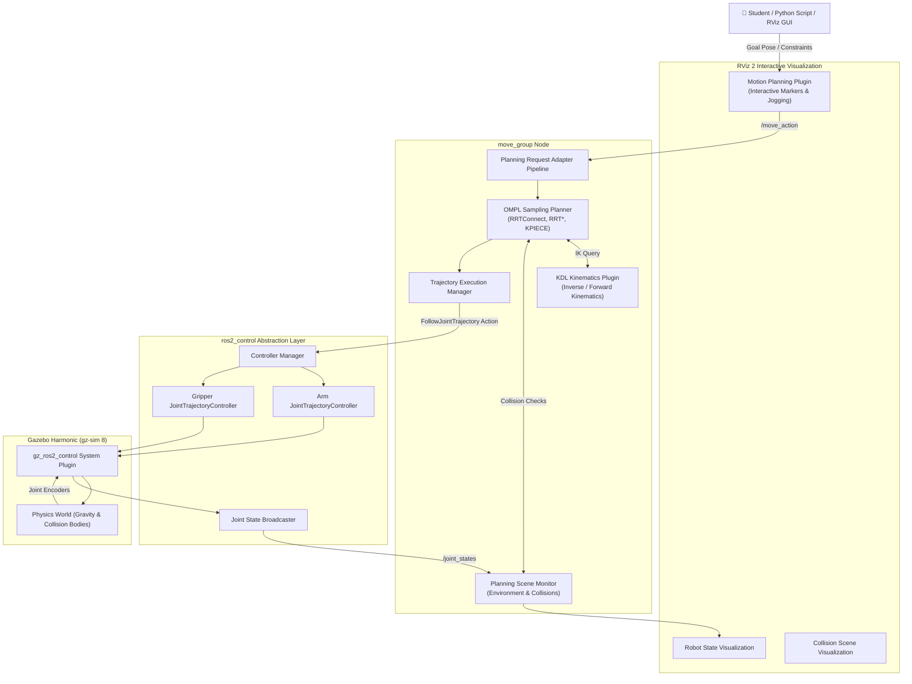

# 🦾 MoveIt 2 & 6-DOF Robot Manipulation Workshop

<div align="center">

[](https://docs.ros.org/en/jazzy/)
[](https://docs.ros.org/en/humble/)
[](https://moveit.ros.org/)
[](https://gazebosim.org/)
[](https://github.com/JosiahSK/moveit2-panda-workshop/actions)
[](./LICENSE)

**A complete, student-ready educational repository for learning MoveIt 2, Kinematics, Trajectory Generation, and Pick-and-Place Manipulation with ROS 2 and Gazebo.**

[Key Concepts](#-moveit-2-key-concepts) •
[Architecture](#-system-architecture) •
[Quickstart](#-quickstart-guide) •
[Launch Modes](#-launch-modes) •
[Lab Curriculum](#-workshop-lab-curriculum) •
[Troubleshooting](#-troubleshooting-faq)

</div>

---

> 📌 **Branch Information:**  
> - **`jazzy`** (Default): Configured for **Ubuntu 24.04**, **ROS 2 Jazzy Jalisco**, and **Gazebo Harmonic (gz-sim 8)** with `gz_ros2_control`.  
> - **`humble`**: Configured for **Ubuntu 22.04**, **ROS 2 Humble Hawksbill**, and **Gazebo Classic / Fortress** with `ign_ros2_control`. Switch using `git checkout humble`.

---

## 🤖 Robot Kinematic Structure

The custom industrial 6-DOF robot arm features an anthropomorphic spherical-wrist layout with a two-finger parallel gripper:

```text
               [gripper / left_finger & right_finger]
                                 │
                             (gripper_joint - Prismatic Mimic)
                                 │
                              [tool0]
                                 │
                             (joint6 - Wrist Roll)
                                 │
                           [wrist_3_link]
                                 │
                             (joint5 - Wrist Pitch)
                                 │
                           [wrist_2_link]
                                 │
                             (joint4 - Forearm Roll)
                                 │
                           [wrist_1_link]
                                 │
                           [forearm_link]
                                 │
                             (joint3 - Elbow Pitch)
                                 │
                          [upper_arm_link]
                                 │
                             (joint2 - Shoulder Pitch)
                                 │
                          [shoulder_link]
                                 │
                             (joint1 - Base Yaw)
                                 │
                            [base_link] === [world]
```

---

## 🏗️ System Architecture



---

## 📦 Package Summary

| Package | Purpose & Key Contents |
|---------|------------------------|
| **[`my_6dof_description`](./src/my_6dof_description/)** | Xacro robot model, links, visual/collision meshes, inertia tensors, and `ros2_control` tags. |
| **[`my_6dof_moveit_config`](./src/my_6dof_moveit_config/)** | Semantic Robot Description (`SRDF`), KDL kinematics, OMPL planner configs, controller definitions, and RViz configs. |
| **[`my_6dof_controllers`](./src/my_6dof_controllers/)** | `ros2_control` parameters for `JointTrajectoryController` and controller spawner scripts. |
| **[`my_6dof_gazebo`](./src/my_6dof_gazebo/)** | Gazebo Harmonic physics world, SDF environment models, and entity spawner nodes. |
| **[`my_6dof_bringup`](./src/my_6dof_bringup/)** | Single-command launch files (`rviz_only`, `demo`, `gazebo_moveit`) and Python Pick-and-Place demo node. |
| **[`panda_ign_moveit2`](./panda_ign_moveit2/)** | Reference Franka Emika Panda packages for comparative robotics study. |

---

## ⚡ Quickstart Guide

### Option A: Native Setup (Ubuntu 24.04 + ROS 2 Jazzy)

```bash
# 1. Source ROS 2 Jazzy
source /opt/ros/jazzy/setup.bash

# 2. Clone the repository
git clone -b jazzy https://github.com/JosiahSK/moveit2-panda-workshop.git ~/moveit2_ws
cd ~/moveit2_ws

# 3. Install dependencies via rosdep
sudo apt-get update
rosdep update
rosdep install --from-paths src --ignore-src -r -y

# 4. Build workspace with colcon
colcon build --symlink-install --cmake-args -DCMAKE_BUILD_TYPE=Release

# 5. Source local workspace
source install/setup.bash
```

### Option B: Docker (Zero Installation)

```bash
# Clone and run directly with GUI display forwarding
git clone https://github.com/JosiahSK/moveit2-panda-workshop.git
cd moveit2-panda-workshop
xhost +local:root
docker compose up
```

---

## 🚀 Launch Modes

This workspace provides four graduated launch modes, taking students from basic kinematics up to full closed-loop simulated manipulation:

### 1️⃣ RViz-Only Mode (Manual Joint Jogging)
*Best for: Inspecting URDF frames, visualizing link geometry, testing joint limits without any planning overhead.*
```bash
ros2 launch my_6dof_bringup rviz_only.launch.py
```

### 2️⃣ MoveIt 2 Demo Mode (Mock Hardware + RViz)
*Best for: Learning OMPL planners, interactive 3D markers, named poses, obstacle collision checking without running physics simulation.*
```bash
ros2 launch my_6dof_bringup demo.launch.py
```

### 3️⃣ Gazebo Harmonic + MoveIt 2 Full Stack
*Best for: Realistic physics, inertia verification, dynamics, and closed-loop `ros2_control` trajectory execution.*
```bash
ros2 launch my_6dof_bringup gazebo_moveit.launch.py
```

### 4️⃣ Automated Pick-and-Place Demo
*Best for: Scripted autonomous manipulation using MoveIt action interfaces.*
```bash
# Terminal 1: Launch Full Stack
ros2 launch my_6dof_bringup gazebo_moveit.launch.py

# Terminal 2: Run Pick-and-Place Node
ros2 run my_6dof_bringup pick_and_place.py
```

---

## 🎓 Workshop Lab Curriculum

A complete hands-on curriculum with guided exercises for instructors and self-learners:

| Module | Lab Exercise | Key Learning Outcomes |
|:------:|--------------|-----------------------|
| 🔬 **Lab 1** | [**RViz Jogging & FK**](./docs/exercises/lab1_rviz_jogging.md) | Forward Kinematics, Link transforms, TF tree inspection, Joint limits. |
| ⚡ **Lab 2** | [**OMPL Motion Planning**](./docs/exercises/lab2_ompl_planners.md) | OMPL algorithms (`RRTConnect` vs `RRT*` vs `KPIECE`), planning time vs path length. |
| 🛡️ **Lab 3** | [**Collision Avoidance**](./docs/exercises/lab3_collision_avoidance.md) | `PlanningSceneMonitor`, publishing obstacles, dynamic obstacle rerouting. |
| 📏 **Lab 4** | [**Cartesian Planning & Gripper**](./docs/exercises/lab4_cartesian_and_gripper.md) | Cartesian straight-line motion, singularity management, gripper control. |
| 🦾 **Lab 5** | [**Full Pick-and-Place Demo**](./docs/exercises/lab5_gazebo_simulation.md) | End-to-end simulated pick-and-place pipeline with Gazebo physics. |

> 📖 **Instructor Syllabus:** View the complete 1-day course schedule in [docs/workshop_curriculum.md](./docs/workshop_curriculum.md).

---

## 💡 MoveIt 2 Key Concepts

### 1. Planning Groups
Configured in `my_6dof.srdf`:
- **`arm`**: Kinematic chain from `base_link` to `tool0`. Handled by KDL Kinematics Solver.
- **`gripper`**: Parallel finger joints (`gripper_joint`, `right_finger_joint`).

### 2. Semantic Named States
Pre-saved joint configurations for predictable state transitions:
- `home`: All joints at zero position `[0, 0, 0, 0, 0, 0]`.
- `ready`: Ready-to-manipulate posture `[0, -0.5, 1.0, -0.5, 0, 0]`.
- `open` / `close`: Gripper jaw positions.

### 3. Collision Matrix (ACM)
Disables collision checking between mechanically impossible pairs (e.g., adjacent links like `base_link` and `shoulder_link`), accelerating motion planning speeds by over **70%**.

---

## ❓ Troubleshooting FAQ

<details>
<summary><strong>❓ RViz shows "No transform from [wrist_3_link] to [base_link]"</strong></summary>

Ensure `robot_state_publisher` is active:
```bash
ros2 node list | grep robot_state_publisher
ros2 topic echo /tf_static --once
```
</details>

<details>
<summary><strong>❓ Motion planning times out or fails</strong></summary>

1. Confirm the target pose lies within the robot's physical reach (~0.85m spherical envelope).
2. Increase planning timeout: In RViz under **Planning Request** → increase **Planning Time (s)** to `5.0` or `10.0`.
3. Try an alternative planner like `RRTstarkConfigDefault` or `PRMkConfigDefault`.
</details>

<details>
<summary><strong>❓ Controllers fail to spawn in Gazebo</strong></summary>

Verify that the `gz_ros2_control` plugin initialized:
```bash
ros2 control list_controllers
```
If controllers are inactive:
```bash
ros2 control set_controller_state arm_controller active
ros2 control set_controller_state gripper_controller active
```
</details>

---

## 🤝 Contributing

We welcome additions of new robot configurations, planners, and tutorials! Please review [CONTRIBUTING.md](./CONTRIBUTING.md) and check [CHANGELOG.md](./CHANGELOG.md) for recent updates.

---

## 📄 License

This repository is distributed under the [MIT License](./LICENSE).  
The Franka Panda model files are licensed under Apache 2.0 per their upstream source.

---

<div align="center">
  <b>Developed for Robotics Education and Workshop Training 🤖</b><br>
  Maintainer: <a href="https://github.com/JosiahSK">JosiahSK</a>
</div>
