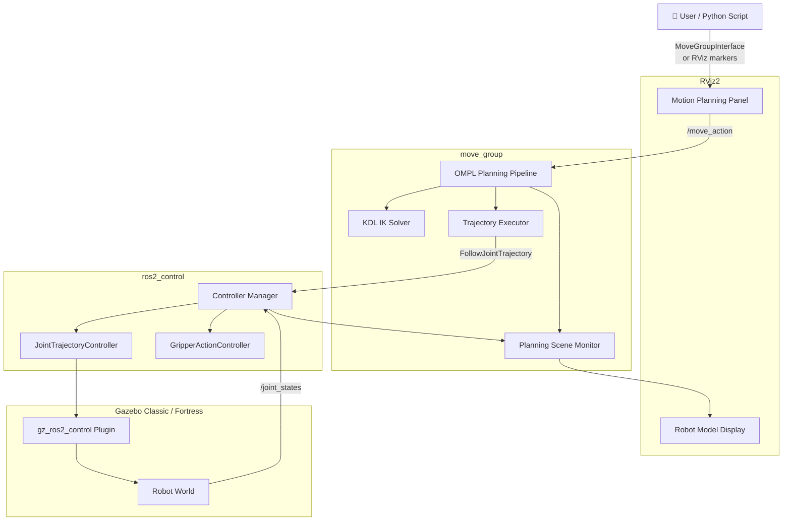

# MoveIt2 6-DOF Robot Workshop

[](https://docs.ros.org/en/humble/)
[](https://docs.ros.org/en/jazzy/)
[](https://moveit.ros.org/)
[](https://gazebosim.org/)
[](./LICENSE)

An **educational MoveIt2 workspace** for learning robot motion planning with a custom 6-DOF arm and the Franka Panda robot. Includes RViz2 interactive motion planning, Gazebo Classic / Fortress simulation, and a Python pick-and-place demo.

> **Branch:** This is the `jazzy` branch (ROS 2 Humble Jalisco + Gazebo Classic / Fortress). For ROS 2 Humble, switch to the [`humble`](https://github.com/JosiahSK/moveit2-panda-workshop/tree/humble) branch.

---

## Table of Contents

1. [What is MoveIt2?](#what-is-moveit2)
2. [System Architecture](#system-architecture)
3. [Package Overview](#package-overview)
4. [Prerequisites](#prerequisites)
5. [Installation & Build](#installation--build)
6. [Launch Modes](#launch-modes)
7. [MoveIt2 Key Concepts](#moveit2-key-concepts)
8. [Motion Planning Tutorial](#motion-planning-tutorial)
9. [Pick & Place Demo](#pick--place-demo)
10. [Directory Structure](#directory-structure)
11. [Troubleshooting FAQ](#troubleshooting-faq)
12. [Contributing & License](#contributing--license)

---

## What is MoveIt2?

[MoveIt2](https://moveit.ros.org/) is the **leading open-source motion planning framework** for ROS 2. It provides:

- **Motion planning** via sampling-based algorithms (OMPL — RRT, PRM, KPIECE, ...)
- **Inverse kinematics** via pluggable solvers (KDL, TracIK, BioIK)
- **Collision checking** using FCL against the robot's URDF geometry
- **Trajectory execution** via the `ros2_control` hardware abstraction layer
- **Interactive manipulation** through the RViz2 Motion Planning plugin
- **Python & C++ APIs** for scripted manipulation tasks

This workspace teaches MoveIt2 concepts by giving you a complete, working 6-DOF robot to experiment with.

---

## System Architecture



📐 See [docs/architecture.md](./docs/architecture.md) for a detailed breakdown including sequence diagrams.

---

## Package Overview

| Package | Description |
|---------|-------------|
| [`my_6dof_description`](./src/my_6dof_description/) | Xacro robot model: 6 joints, gripper, inertias, `ros2_control` tags |
| [`my_6dof_moveit_config`](./src/my_6dof_moveit_config/) | SRDF, KDL kinematics, OMPL planners, controller mapping, RViz config |
| [`my_6dof_controllers`](./src/my_6dof_controllers/) | `ros2_control` YAML configs + controller spawner launch |
| [`my_6dof_gazebo`](./src/my_6dof_gazebo/) | Gazebo Classic / Fortress SDF world + entity spawner |
| [`my_6dof_bringup`](./src/my_6dof_bringup/) | Top-level launch files + `pick_and_place.py` demo |
| [`panda_description`](./panda_ign_moveit2/panda_description/) | Franka Panda URDF + meshes (reference robot) |
| [`panda_moveit_config`](./panda_ign_moveit2/panda_moveit_config/) | Panda MoveIt2 SRDF + config (reference) |

📦 See [docs/package_overview.md](./docs/package_overview.md) for file-level details.

---

## Prerequisites

### Hardware / OS
- Ubuntu 24.04 LTS (jazzy branch) or 22.04 LTS (humble branch)
- 8 GB RAM minimum (16 GB recommended for Gazebo)
- GPU recommended for Gazebo rendering (software rendering works but is slow)

### Software
```bash
# Check ROS 2 Humble is installed
ros2 --version          # expected: ros2cli 0.x.x

# Check MoveIt2
ros2 pkg list | grep moveit  # should list moveit_ros_planning etc.

# Check Gazebo Classic / Fortress
gz sim --version        # expected: Gazebo Sim, version 8.x.x

# Check colcon
colcon version-check
```

---

## Installation & Build

### ROS 2 Humble (this branch — default)

```bash
# 1. Source ROS 2 Humble
source /opt/ros/humble/setup.bash

# 2. Clone this repo
git clone https://github.com/JosiahSK/moveit2-panda-workshop.git ~/moveit2_ws
cd ~/moveit2_ws

# 3. Install system dependencies
sudo apt install -y \
  ros-jazzy-moveit \
  ros-jazzy-ros2-control \
  ros-jazzy-ros2-controllers \
  ros-jazzy-gz-ros2-control \
  ros-jazzy-rviz-visual-tools

# 4. Install rosdep dependencies
rosdep update
rosdep install --from-paths src --ignore-src -r -y

# 5. Build
colcon build --symlink-install --cmake-args -DCMAKE_BUILD_TYPE=Release

# 6. Source the workspace
source install/setup.bash
```

### ROS 2 Humble (humble branch)

```bash
git clone -b humble https://github.com/JosiahSK/moveit2-panda-workshop.git ~/moveit2_ws
cd ~/moveit2_ws
source /opt/ros/humble/setup.bash
rosdep update && rosdep install --from-paths src --ignore-src -r -y
colcon build --symlink-install
source install/setup.bash
```

> See [docs/humble_notes.md](./docs/humble_notes.md) for Humble-specific details.

---

## Launch Modes

Always source your workspace first:
```bash
source ~/moveit2_ws/install/setup.bash
```

### Mode 1 — RViz Only (fastest, no simulation)
```bash
ros2 launch my_6dof_bringup rviz_only.launch.py
```
**Starts:** `robot_state_publisher` + `joint_state_publisher_gui` + `rviz2`

**Use for:** Checking your robot model, viewing the URDF, testing RViz config. No motion planning.

---

### Mode 2 — MoveIt2 Demo (fake hardware)
```bash
ros2 launch my_6dof_bringup demo.launch.py
```
**Starts:** Everything in Mode 1 + `move_group` + fake joint controllers

**Use for:** Motion planning experiments without Gazebo overhead. Plans and "executes" trajectories on fake hardware — robot moves instantly.

---

### Mode 3 — Full Gazebo + MoveIt2 Simulation
```bash
ros2 launch my_6dof_bringup gazebo_moveit.launch.py
```
**Starts:** Gazebo Classic / Fortress + `move_group` + `ros2_control` + real PID controllers + RViz2

**Use for:** Physics-accurate simulation. Robot moves realistically with inertia and joint limits enforced by the Gazebo physics engine.

> ⏳ Takes ~30 seconds to fully initialize. Wait for:
> ```
> [move_group]: All is well! Everyone is happy! You can start planning now!
> ```

---

### Mode 4 — Pick & Place Demo
After launching Mode 3 in one terminal:
```bash
# In a new terminal
source ~/moveit2_ws/install/setup.bash
ros2 run my_6dof_bringup pick_and_place.py
```
**Runs:** A Python script that sends a full pick-and-place sequence via the MoveIt2 API.

---

## MoveIt2 Key Concepts

### Planning Groups (SRDF)
A **planning group** is a named set of joints that are planned together. This workspace has two groups:
- `arm` — joints 1–6 (the robot arm)
- `gripper` — the gripper joint

Defined in `src/my_6dof_moveit_config/config/my_6dof.srdf`.

### OMPL — Open Motion Planning Library
The planning algorithm used. Default planner: **RRTConnect** (bidirectional Rapidly-exploring Random Tree). It:
1. Grows two trees from start and goal simultaneously
2. Samples random configurations in joint space
3. Connects trees when they meet
4. Post-processes the path (shortcutting + time-parameterization)

### KDL Kinematics
**KDL** (Kinematics and Dynamics Library) computes **inverse kinematics** — given a desired end-effector pose (position + orientation), find the joint angles that achieve it. Uses iterative numerical solving.

### ros2_control
The **hardware abstraction layer** that standardises how software sends commands to robot hardware (or simulation). Controllers (`JointTrajectoryController`) receive trajectories from MoveIt2 and output joint position/velocity commands.

📖 Deep dive: [docs/motion_planning.md](./docs/motion_planning.md)

---

## Motion Planning Tutorial

### Step 1 — Launch the demo
```bash
ros2 launch my_6dof_bringup demo.launch.py
```

### Step 2 — Set the Planning Group
In the **Motion Planning** panel (left side of RViz):
- Expand **Planning Request**
- Set **Planning Group** → `arm`

### Step 3 — Set a Goal
**Option A — Named pose:**
Under **Goal State**, select `ready` from the dropdown → click **Update**

**Option B — Interactive marker:**
Drag the coloured arrows/rings at the end-effector in the 3D viewport

**Option C — Random:**
Click **Random Valid** for a random reachable configuration

### Step 4 — Plan
Click the **Plan** button. A ghost (orange/translucent) trajectory preview appears.

### Step 5 — Execute
Click **Execute** to run the trajectory on the (fake) hardware. The robot snaps to the goal.

### Step 6 — Try with Gazebo
Repeat with `gazebo_moveit.launch.py` — now the robot moves with physics!

---

## Pick & Place Demo

The `pick_and_place.py` script demonstrates the full manipulation pipeline:

```
Home → Approach → Descend → Grasp → Lift → Transport → Place → Release → Retreat → Home
```

```bash
# Terminal 1 — full simulation
ros2 launch my_6dof_bringup gazebo_moveit.launch.py

# Terminal 2 — run demo
ros2 run my_6dof_bringup pick_and_place.py
```

📖 Full walkthrough: [docs/pick_and_place.md](./docs/pick_and_place.md)

---

## Directory Structure

```
moveit2_ws/
├── src/
│   ├── my_6dof_description/       # 🤖 Robot URDF/Xacro model
│   │   ├── urdf/my_6dof.urdf.xacro
│   │   └── launch/display.launch.py
│   ├── my_6dof_moveit_config/     # 🧠 MoveIt2 configuration
│   │   ├── config/
│   │   │   ├── my_6dof.srdf       # Planning groups, named poses
│   │   │   ├── kinematics.yaml    # KDL IK settings
│   │   │   ├── ompl_planning.yaml # OMPL planner config
│   │   │   ├── moveit_controllers.yaml
│   │   │   └── joint_limits.yaml
│   │   └── launch/move_group.launch.py
│   ├── my_6dof_controllers/       # ⚙️ ros2_control configs
│   │   └── config/ros2_controllers.yaml
│   ├── my_6dof_gazebo/            # 🌍 Simulation world
│   │   └── worlds/my_6dof_world.sdf
│   ├── my_6dof_bringup/           # 🚀 Launch entry points
│   │   ├── launch/
│   │   │   ├── rviz_only.launch.py
│   │   │   ├── demo.launch.py
│   │   │   └── gazebo_moveit.launch.py
│   │   └── scripts/pick_and_place.py
│   └── deps/                      # 📦 Vendored deps (not in git)
├── panda_ign_moveit2/             # 🦾 Franka Panda reference
│   ├── panda_description/
│   └── panda_moveit_config/
├── docs/                          # 📚 Educational documentation
│   ├── architecture.md
│   ├── getting_started.md
│   ├── motion_planning.md
│   ├── pick_and_place.md
│   ├── package_overview.md
│   ├── humble_notes.md
│   ├── jazzy_notes.md
│   └── screenshots/
├── README.md
├── .gitignore
└── panda_ign_moveit2.repos        # vcs import file for Panda
```

---

## Troubleshooting FAQ

<details>
<summary><strong>❓ RViz shows "No transform from [link1] to [base_link]"</strong></summary>

The `robot_state_publisher` isn't running or hasn't received the robot description yet.

```bash
# Check it's running
ros2 node list | grep robot_state_publisher

# Check the robot description parameter
ros2 param get /robot_state_publisher robot_description | head -5
```
</details>

<details>
<summary><strong>❓ Motion planning always times out / fails</strong></summary>

1. Check if the goal pose is reachable (not outside the arm's workspace)
2. Increase planning time: in RViz → Planning Request → **Planning Time (s)** → set to `10.0`
3. Check for collision objects blocking the path
4. Try a different planner: change **Planner** dropdown from `RRTConnect` to `RRT` or `KPIECE`
</details>

<details>
<summary><strong>❓ Gazebo starts but the robot falls through the floor</strong></summary>

The physics plugin isn't connecting. Check:
```bash
ros2 topic list | grep joint_states
# Should show /joint_states from gz_ros2_control
```
If empty, the `gz_ros2_control` plugin failed to load. Check the Gazebo terminal for plugin errors.
</details>

<details>
<summary><strong>❓ "colcon build" fails with "Could not find package moveit_core"</strong></summary>

You haven't sourced ROS 2:
```bash
source /opt/ros/humble/setup.bash   # Jazzy
# or
source /opt/ros/humble/setup.bash  # Humble
```
Then rebuild.
</details>

<details>
<summary><strong>❓ pick_and_place.py exits immediately with "Planning failed"</strong></summary>

The `move_group` isn't ready yet. Wait until you see:
```
[move_group]: All is well! Everyone is happy! You can start planning now!
```
Then run the script.
</details>

<details>
<summary><strong>❓ Gripper doesn't open or close</strong></summary>

Check the gripper controller is active:
```bash
ros2 control list_controllers
# Should show gripper_controller: active
```
If inactive: `ros2 control set_controller_state gripper_controller active`
</details>

---

## Documentation

| Document | Contents |
|----------|---------|
| [Architecture](./docs/architecture.md) | System diagram, node graph, topic table |
| [Getting Started](./docs/getting_started.md) | Full install + first launch guide |
| [Motion Planning](./docs/motion_planning.md) | OMPL, KDL, SRDF, collision checking |
| [Pick & Place](./docs/pick_and_place.md) | Demo walkthrough + API reference |
| [Package Overview](./docs/package_overview.md) | Every file explained |
| [Jazzy Notes](./docs/jazzy_notes.md) | Jazzy-specific details |
| [Humble Notes](./docs/humble_notes.md) | Humble migration notes |

---

## Contributing & License

Contributions, bug reports, and improvements are welcome!

### Contributing
1. Fork this repository
2. Create a feature branch: `git checkout -b feat/your-feature`
3. Commit your changes: `git commit -m "feat: add your feature"`
4. Push: `git push origin feat/your-feature`
5. Open a Pull Request against the `jazzy` branch

### Branch Policy
- `jazzy` — primary branch (ROS 2 Humble + Gazebo Classic / Fortress)
- `humble` — maintenance branch (ROS 2 Humble + Gazebo Classic/Fortress)

### License
This project is licensed under the **MIT License** — see [LICENSE](./LICENSE) for details.

The Franka Panda URDF and meshes in `panda_ign_moveit2/` are licensed under the **Apache 2.0 License** per their upstream source.

---

<p align="center">
  Built for teaching MoveIt2 and ROS 2 robot manipulation 🤖<br>
  <a href="https://moveit.ros.org/">MoveIt2</a> •
  <a href="https://docs.ros.org/en/jazzy/">ROS 2 Humble</a> •
  <a href="https://gazebosim.org/">Gazebo Classic / Fortress</a>
</p>
