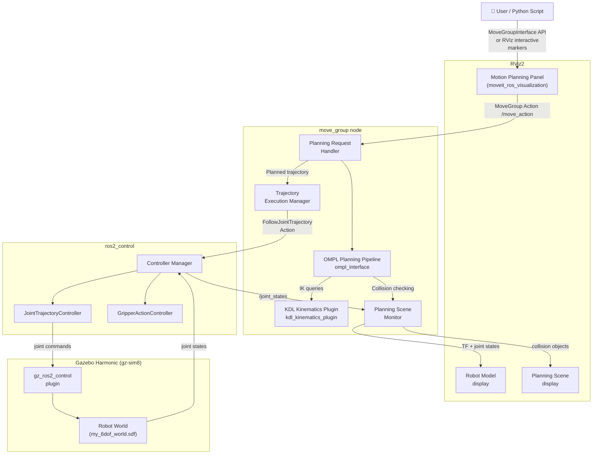
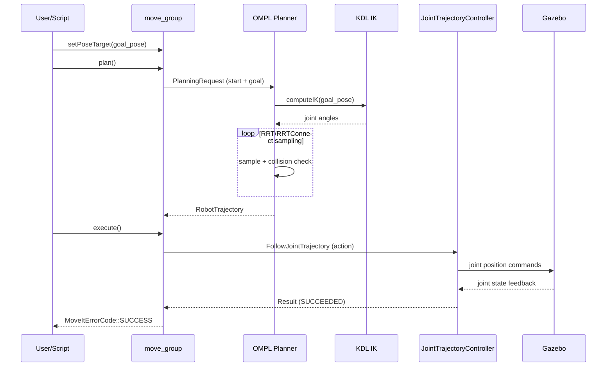

# System Architecture

This document describes the software architecture of the **my_6dof** MoveIt2 robot workspace. Understanding how the components connect will help you debug, extend, and tune the system.

---

## High-Level Architecture

---

## Component Details

### 1. `my_6dof_description`
Provides the **URDF/Xacro robot model**:
- 6 revolute joints (arm)
- 1 gripper with 2 mimic finger joints
- Inertia tensors for each link
- Visual meshes + collision geometry
- `<ros2_control>` hardware interface tags (for simulation)

### 2. `my_6dof_moveit_config`
Houses all **MoveIt2 configuration** files:
| File | Purpose |
|------|---------|
| `config/my_6dof.srdf` | Semantic robot description (planning groups, poses, collisions) |
| `config/kinematics.yaml` | KDL solver parameters (timeout, attempts) |
| `config/ompl_planning.yaml` | OMPL planner configuration and defaults |
| `config/moveit_controllers.yaml` | Maps MoveIt trajectories → ros2_control actions |
| `config/joint_limits.yaml` | Velocity/acceleration limits per joint |
| `config/my_6dof.rviz` | Pre-configured RViz2 layout |

### 3. `my_6dof_controllers`
Defines **ros2_control** controller configurations:
- `ros2_controllers.yaml` — JointTrajectoryController for the arm + GripperActionController
- Spawner launch file that activates controllers after robot_state_publisher starts

### 4. `my_6dof_gazebo`
Provides the **simulation environment**:
- Gazebo Harmonic (gz-sim8) SDF world
- Entity spawner (launches the robot into the world from URDF)
- Bridge configuration between Gazebo topics ↔ ROS 2 topics

### 5. `my_6dof_bringup`
**Top-level launch orchestration** — the entry point for users:
| Launch File | What it starts |
|-------------|---------------|
| `rviz_only.launch.py` | Robot state publisher + RViz2 (no simulation) |
| `demo.launch.py` | RViz2 + MoveIt2 move_group (no Gazebo) |
| `gazebo_moveit.launch.py` | Full stack: Gazebo + MoveIt2 + RViz2 |

Also contains `scripts/pick_and_place.py` — a Python demo using `MoveGroupInterface`.

### 6. `panda_ign_moveit2`
**Franka Panda** reference packages:
- `panda_description` — official Panda URDF/meshes
- `panda_moveit_config` — Panda MoveIt2 SRDF + configs

These serve as a reference for students comparing their custom arm to the Panda.

---

## Data Flow: Planning a Motion

---

## Key ROS 2 Topics & Actions

| Name | Type | Description |
|------|------|-------------|
| `/joint_states` | `sensor_msgs/JointState` | Current joint positions from controller |
| `/move_group/goal` | `moveit_msgs/MoveGroupAction` | Motion planning requests |
| `/arm_controller/follow_joint_trajectory` | `control_msgs/FollowJointTrajectoryAction` | Trajectory execution |
| `/gripper_controller/gripper_cmd` | `control_msgs/GripperCommandAction` | Gripper open/close |
| `/planning_scene` | `moveit_msgs/PlanningScene` | Collision environment |
| `/tf` | `tf2_msgs/TFMessage` | Robot transforms |

---

## See Also

- [Getting Started](./getting_started.md)
- [Motion Planning Concepts](./motion_planning.md)
- [Pick & Place Demo](./pick_and_place.md)
