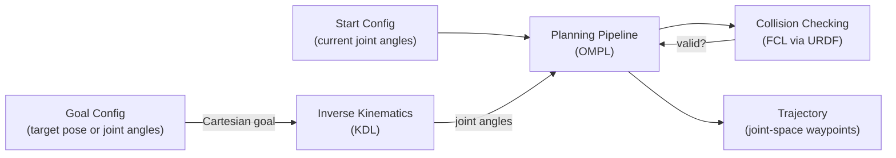
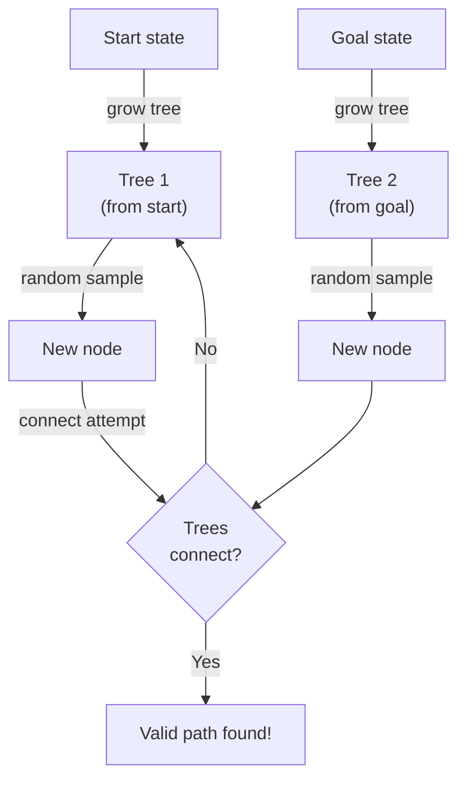
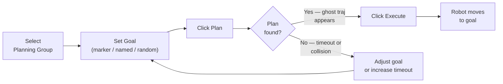

# Motion Planning with MoveIt2

This document covers the motion planning concepts you'll encounter when working with this workspace, and walks you through using the RViz2 Motion Planning plugin interactively.

---

## What is Motion Planning?

Motion planning is the problem of finding a **collision-free path** for a robot from a **start configuration** to a **goal configuration**, respecting joint limits, velocities, and environment constraints.



---

## Key Concepts

### Planning Groups (SRDF)

A **planning group** is a named subset of joints that MoveIt2 plans for together. Defined in `config/my_6dof.srdf`:

```xml
<group name="arm">
  <joint name="joint1" />
  <joint name="joint2" />
  <joint name="joint3" />
  <joint name="joint4" />
  <joint name="joint5" />
  <joint name="joint6" />
</group>

<group name="gripper">
  <joint name="gripper_joint" />
</group>
```

**Why groups matter:**
- You can plan the arm independently from the gripper
- Each group can have its own end-effector and IK solver
- Allowed collision pairs are defined per group in the SRDF

### Named Poses

The SRDF also stores **named configurations** (presets):

| Name | Description |
|------|-------------|
| `home` | All joints at 0° — upright position |
| `ready` | Arm raised, ready for workspace operations |

These appear as buttons in the RViz Motion Planning panel.

---

## OMPL: Open Motion Planning Library

This workspace uses **OMPL** as the planning library. OMPL provides sampling-based planners.

### Available Planners (configured in `ompl_planning.yaml`)

| Planner | Type | Best For |
|---------|------|---------|
| **RRTConnect** *(default)* | Bidirectional RRT | General use, fast convergence |
| **RRT** | Randomized exploration | Simple environments |
| **KPIECE** | Kinodynamic planning | Complex joint limits |
| **BiTRRT** | Bidirectional T-RRT | Smooth paths |
| **PRM** | Probabilistic roadmap | Repeated queries in static scenes |

### How RRTConnect Works



1. Two trees grow simultaneously — one from start, one from goal
2. At each iteration, a random state is sampled in C-space
3. Both trees try to grow toward the sample
4. When the trees connect, the path is extracted and post-processed (shortcutting, time-parameterization)

### Tuning OMPL

Edit `config/ompl_planning.yaml`:

```yaml
arm:
  planner_configs:
    - RRTConnectkConfigDefault
  RRTConnectkConfigDefault:
    type: geometric::RRTConnect
    range: 0.0          # max step size (0 = auto)
    
planning_plugin: ompl_interface/OMPLPlanner
request_adapters: >-
  default_planner_request_adapters/AddTimeParameterization
  default_planner_request_adapters/ResolveConstraintFrames
  default_planner_request_adapters/FixWorkspaceBounds
  default_planner_request_adapters/FixStartStateBounds
  default_planner_request_adapters/FixStartStateCollision
  default_planner_request_adapters/FixStartStatePathConstraints
```

---

## Inverse Kinematics: KDL Solver

**KDL (Kinematics and Dynamics Library)** is the default IK solver, configured in `config/kinematics.yaml`:

```yaml
arm:
  kinematics_solver: kdl_kinematics_plugin/KDLKinematicsPlugin
  kinematics_solver_search_resolution: 0.005  # rad
  kinematics_solver_timeout: 0.005            # seconds per attempt
  kinematics_solver_attempts: 3
```

KDL uses **numerical (iterative) IK** — it starts from a seed configuration and iterates using the Jacobian pseudo-inverse until it converges.

> [!TIP]
> If KDL often fails to find IK solutions (especially for poses near singularities), try increasing `kinematics_solver_attempts` or switch to the `trac_ik` plugin for better coverage.

---

## Collision Checking

MoveIt2 uses **FCL (Flexible Collision Library)** to check for collisions between:
- Robot links vs each other (self-collision)
- Robot links vs the planning scene (environment)

### Allowed Collision Matrix (ACM)
Adjacent links that are always touching are listed in the SRDF's `<disable_collisions>` section so the planner doesn't waste time checking them:

```xml
<disable_collisions link1="base_link" link2="link1" reason="Adjacent" />
<disable_collisions link1="link1" link2="link2" reason="Adjacent" />
```

### Adding Collision Objects at Runtime

```python
from moveit.core.planning_scene_monitor import PlanningSceneMonitor
# or via MoveGroupInterface:
scene = moveit_commander.PlanningSceneInterface()
box = CollisionObject()
box.id = "table"
box.primitives = [SolidPrimitive(type=SolidPrimitive.BOX, dimensions=[0.5, 0.8, 0.05])]
scene.add_object(box)
```

---

## Using the RViz2 Motion Planning Panel

### Step 1: Set the Planning Group
In the **Motion Planning** panel on the left:
- Expand **Planning Request**
- Set **Planning Group** → `arm`

### Step 2: Set a Goal State
**Option A — Named pose:**
- Under **Goal State**, click the dropdown and select `ready` or `home`
- Click **Update**

**Option B — Interactive marker:**
- In the viewport, drag the **blue/orange interactive marker** at the end-effector
- The arm IK preview follows in orange

**Option C — Random valid:**
- Click **Random Valid** to generate a random reachable pose

### Step 3: Plan
- Click the **Plan** button
- Watch the ghost trajectory appear in the viewport
- The planning status shows in the **Status** area at the bottom

### Step 4: Execute
- Click **Execute** to send the trajectory to the controller
- Or click **Plan & Execute** to do both in one step

### Step 5: Check the Result
- The robot (or Gazebo simulation) moves to the goal
- Joint states update in RViz



---

## Trajectory Post-Processing

After a raw path is found, MoveIt2 applies **request adapters** (in order):

1. **FixStartStateBounds** — clamps start joint values to limits
2. **FixStartStateCollision** — jitters start if in collision
3. **AddTimeParameterization** — converts geometric path → time-stamped trajectory respecting velocity/acceleration limits from `joint_limits.yaml`

The output is a `trajectory_msgs/JointTrajectory` with timing you can inspect:
```bash
ros2 topic echo /arm_controller/follow_joint_trajectory/goal
```

---

## Constraints

MoveIt2 supports path and goal constraints:

```python
# Keep end-effector upright during motion
from moveit_msgs.msg import OrientationConstraint
oc = OrientationConstraint()
oc.link_name = "link6"
oc.orientation.w = 1.0
oc.absolute_x_axis_tolerance = 0.1
oc.absolute_y_axis_tolerance = 0.1
oc.absolute_z_axis_tolerance = 3.14  # allow full rotation around Z
oc.weight = 1.0
move_group.set_path_constraints(oc)
```

---

## See Also

- [Architecture Overview](./architecture.md)
- [Pick & Place Demo](./pick_and_place.md)
- [OMPL Documentation](https://ompl.kavrakilab.org/)
- [MoveIt2 Documentation](https://moveit.picknik.ai/)
