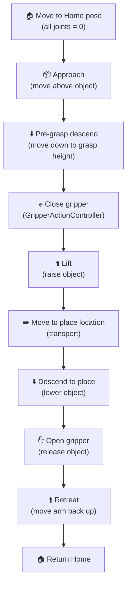

# Pick and Place Demo

This guide explains the `pick_and_place.py` script — the flagship demo of this workspace. It demonstrates a complete manipulation sequence using the MoveIt2 Python API.

---

## What the Demo Does

The pick-and-place sequence moves the 6-DOF arm through five stages:



---

## Running the Demo

### Prerequisites
You must have the full Gazebo + MoveIt2 stack running first:

```bash
# Terminal 1 — start the full simulation
ros2 launch my_6dof_bringup gazebo_moveit.launch.py
```

Wait until you see:
```
[move_group-...]: All is well! Everyone is happy! You can start planning now!
```

Then in a second terminal:
```bash
# Terminal 2 — run the demo
source ~/moveit2_ws/install/setup.bash
ros2 run my_6dof_bringup pick_and_place.py
```

---

## Script Walkthrough

### Node Initialization

```python
import rclpy
from rclpy.node import Node
from moveit.planning import MoveItPy
from moveit.core.robot_state import RobotState

rclpy.init()
node = Node("pick_and_place_demo")
moveit = MoveItPy(node_name="pick_and_place_demo")
arm = moveit.get_planning_component("arm")
gripper = moveit.get_planning_component("gripper")
```

The script:
1. Initialises `rclpy` and creates a ROS 2 node
2. Creates a `MoveItPy` instance — this connects to the running `move_group`
3. Gets two **planning components**: `arm` and `gripper`

### Stage 1 — Move to Home

```python
arm.set_start_state_to_current_state()
arm.set_goal_state(configuration_name="home")
plan_result = arm.plan()
if plan_result:
    moveit.execute(plan_result.trajectory, controllers=[])
```

Queries MoveIt2 for the named pose `"home"` defined in the SRDF.

### Stage 2 — Approach (Cartesian goal)

```python
from geometry_msgs.msg import Pose
goal_pose = Pose()
goal_pose.position.x = 0.4
goal_pose.position.y = 0.0
goal_pose.position.z = 0.35   # above object
goal_pose.orientation.w = 1.0

arm.set_goal_state(pose_stamped_msg=goal_pose, pose_link="link6")
```

Uses a **Cartesian (6D pose)** goal. MoveIt2 runs KDL IK to convert this to joint angles, then plans a collision-free path.

### Stage 3 — Descend to Grasp

A second Cartesian goal with lower Z, or a **Cartesian path** (straight-line motion):

```python
waypoints = []
wpose = copy.deepcopy(current_pose)
wpose.position.z -= 0.15   # descend 15 cm
waypoints.append(copy.deepcopy(wpose))

(plan, fraction) = arm.compute_cartesian_path(
    waypoints,
    eef_step=0.01,      # 1 cm resolution
    jump_threshold=0.0  # disable jump detection
)
```

> [!TIP]
> `compute_cartesian_path` returns a `fraction` (0.0–1.0) indicating how much of the requested path was achievable. A fraction < 0.9 usually means a singularity or collision blocked the path.

### Stage 4 — Close Gripper

```python
gripper.set_goal_state(configuration_name="closed")
plan_result = gripper.plan()
if plan_result:
    moveit.execute(plan_result.trajectory, controllers=[])
```

The gripper planning group closes the finger joints to grip the object.

### Stage 5–9 — Lift, Transport, Place, Release, Retreat

Same pattern as stages 2–4 but with different target poses. The script uses `time.sleep()` between stages to ensure each action completes before the next begins.

---

## Modifying the Demo

### Change the Pick Location

Edit the approach pose in `scripts/pick_and_place.py`:
```python
# Adjust these coordinates for your object position
PICK_X = 0.4
PICK_Y = 0.0
PICK_Z_ABOVE = 0.35   # hover height
PICK_Z_GRASP = 0.20   # grasp height
```

### Change the Place Location

```python
PLACE_X = 0.0
PLACE_Y = 0.4
PLACE_Z_ABOVE = 0.35
PLACE_Z_PLACE = 0.20
```

### Add a Collision Object (Table/Box)

Before planning, add a collision object to the planning scene so the arm avoids it:

```python
from moveit_msgs.msg import CollisionObject
from shape_msgs.msg import SolidPrimitive

table = CollisionObject()
table.id = "table"
table.header.frame_id = "base_link"
box = SolidPrimitive(type=SolidPrimitive.BOX)
box.dimensions = [0.8, 0.8, 0.05]  # 80x80x5 cm table
table.primitives = [box]
table.primitive_poses = [Pose(position=Point(x=0.4, y=0.0, z=0.1))]
table.operation = CollisionObject.ADD
```

---

## Troubleshooting the Demo

| Symptom | Likely Cause | Fix |
|---------|-------------|-----|
| Planning fails repeatedly | Goal pose unreachable / in collision | Adjust PICK_X/Y/Z; check collision objects |
| Gripper doesn't close | GripperActionController not active | Run `ros2 control list_controllers` |
| Arm vibrates after grasp | Joint limits violated | Check `joint_limits.yaml` velocity settings |
| Demo exits immediately | `move_group` not ready | Wait for "You can start planning now!" |
| `fraction < 0.9` warning | Singularity in Cartesian path | Change waypoint orientation or increase `eef_step` |

---

## Key API Reference

| Method | Description |
|--------|-------------|
| `arm.set_start_state_to_current_state()` | Use current robot state as start |
| `arm.set_goal_state(configuration_name=...)` | Use SRDF named pose |
| `arm.set_goal_state(pose_stamped_msg=..., pose_link=...)` | Use Cartesian goal |
| `arm.plan()` | Run motion planner |
| `moveit.execute(trajectory)` | Send trajectory to controller |
| `arm.compute_cartesian_path(waypoints, ...)` | Straight-line Cartesian motion |

---

## See Also

- [Motion Planning Concepts](./motion_planning.md)
- [Architecture Overview](./architecture.md)
- [MoveIt2 Python API](https://moveit.picknik.ai/main/doc/examples/motion_planning_python_api/motion_planning_python_api_tutorial.html)
